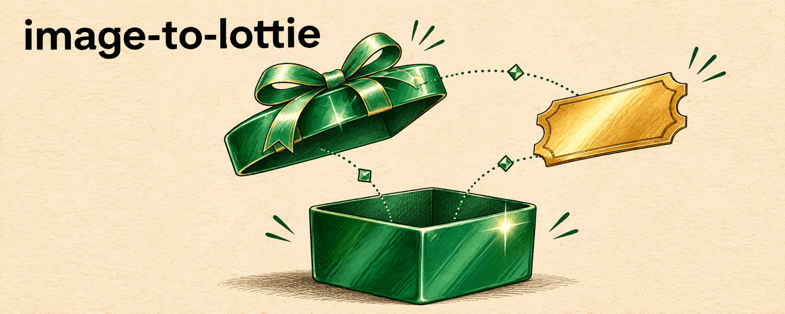
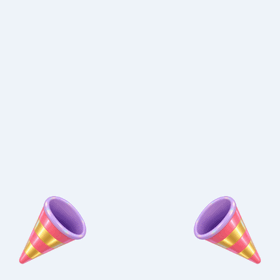
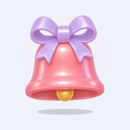
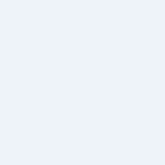
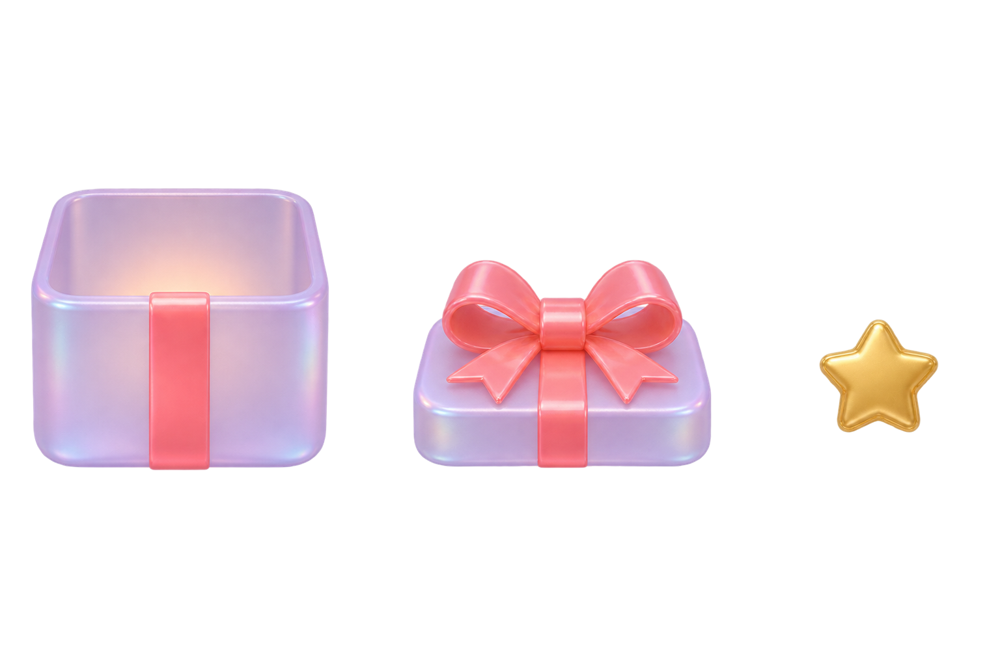
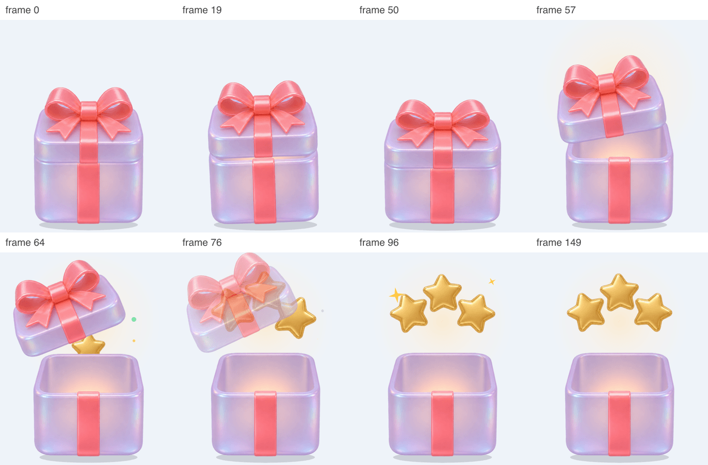

<p align="center">
  
</p>

<p align="center">
  <a href="README.md">English</a> · <b>한국어</b>
</p>

# image-to-lottie

**AI로 만든 이미지를 Lottie·dotLottie 애니메이션으로 바꾸고, 브라우저 없이 프레임마다 확인합니다.**

<p align="center">
  
  
  
</p>
<p align="center">
  
  
  
</p>

## 무엇인가

명령줄 도구이자 Claude Code·Codex용 에이전트 스킬입니다. 상자, 뚜껑, 보상처럼 정지 이미지 몇 장을 만들면 이 도구가 조각을 자르고, 맞추고, 모션 프리셋으로 움직여 Lottie JSON이나 `.lottie` 파일로 만듭니다. 결과는 Chrome과 Flutter가 쓰는 Lottie 플레이어인 Skia Skottie로 렌더링해 PNG, 프레임 모음 이미지, GIF로 바로 볼 수 있습니다.

## 왜 만들었나

완성도 높은 앱 애니메이션은 대개 3D 정지 이미지 몇 장을 2D로 움직이는 식으로 만듭니다. 이걸 AI 에이전트로 하면 늘 같은 곳에서 막혔습니다. 조각을 따로 생성하면 스타일과 비율이 어긋났습니다. 뚜껑 위치는 눈대중으로 여러 번 맞춰야 했습니다. 플레이어가 WebGL로 그려서 프레임 하나를 보려면 브라우저 화면을 캡처해야 했고, 이미지 경로도 자주 틀어졌습니다. 기존 이미지→Lottie 도구는 그림 한 장이나 프레임 묶음을 감싸기만 하고, 조각을 따로 움직이지는 못합니다. 이 도구는 그 단계들을 정리해서, 에이전트가 프롬프트 한 번으로 검증된 `.lottie`까지 가게 합니다.

## 하는 일

| 명령 | 하는 일 |
| --- | --- |
| `split` | 투명 배경 한 장에 그린 여러 물체(조각 시트)를 물체별 PNG로 자릅니다. 가까이 떨어진 작은 조각은 그 물체에 합칩니다. |
| `fit` | 뚜껑을 몸통에 여러 깊이로 겹쳐 번호를 붙인 이미지를 만듭니다. 닫혀 보이는 값을 고르면 됩니다. |
| `spin` | 정면 이미지 한 장으로 동전이 도는 프레임을 만듭니다. |
| `build` | 프리셋을 적용해 이미지와 함께 Lottie JSON을 쓰고, `.lottie`나 이미지 내장 JSON도 만듭니다. |
| `render` | Skottie로 브라우저 없이 렌더링합니다. PNG 프레임, 번호 붙은 프레임 모음, GIF. |
| `check` | 파일이 열리는지, 이미지가 다 있는지, 중간·마지막 프레임이 비지 않았는지 확인합니다. 내용이 화면 가장자리에 닿거나 이미지가 표시 크기보다 지나치게 크면 경고합니다. |
| `pack` | 어떤 Lottie든 dotLottie(이미지 내장)나 base64 이미지가 든 JSON 한 파일로 바꿉니다. |
| `inspect`, `edit` | 어떤 Lottie든 레이어 목록을 보고, 레이어 하나의 위치·크기·회전·투명도·타이밍을 바꿉니다. |

프리셋:

| 프리셋 | 조각 | 재생 |
| --- | --- | --- |
| `gift-open` | `base`, `lid`, `item` | 상자가 두 번 들썩이고, 뚜껑이 날아가고, 보상이 솟아 부채꼴로 펼쳐집니다. 한 번 재생 후 멈춤. |
| `hop` | `subject` | 웅크렸다 뛰고, 공중에서 흔들리고, 착지하며 찌그러진 뒤 숨 쉬듯 움직입니다. 반복. |
| `float` | `subject` | 둥실 떠서 살짝 흔들리고, 그림자와 빛이 숨 쉬듯 변합니다. 반복. |
| `pop-in` | `subject` | 빛이 터지고 알갱이·반짝이와 함께 튀어나옵니다. 한 번 재생 후 멈춤. |
| `fanfare` | `popper` | 양쪽 아래 모서리의 폭죽이 살짝 젖혔다가 펑 터지고, 색종이가 포물선을 그리며 날다 떨어집니다. 한 번 재생 후 멈춤. |
| `sequence` | 프레임 이미지들 | 파일 이름 순서대로 넘기는 플립북. 반복. |

## 예시

`examples/gift-open` 폴더입니다. 생성한 조각 시트 한 장에서 `.lottie`까지 갑니다.

<p align="center">
  
</p>

```console
$ image-to-lottie split examples/gift-open/sheet.png -o examples/gift-open/parts --names base,lid,item
base	475x450	examples/gift-open/parts/base.png
lid	475x337	examples/gift-open/parts/lid.png
item	200x190	examples/gift-open/parts/item.png

$ image-to-lottie fit examples/gift-open/parts/base.png examples/gift-open/parts/lid.png -o examples/gift-open/fit.png
sheet: examples/gift-open/fit.png
candidates: 130, 156, 182, 200, 217, 243
suggested starting point: overlap 200. Pick the smallest overlap where the opening is fully hidden.
```

156에서는 틈으로 빛이 보이고, 182가 닫혀 보이는 가장 작은 값이라 `examples/gift-open/config.json`에 `"overlap": 182`를 넣었습니다.

```console
$ image-to-lottie build examples/gift-open/config.json -o examples/gift-open/out/gift-open.json --lottie examples/gift-open/out/gift-open.lottie
lottie: examples/gift-open/out/gift-open.json (600x720, 150 frames @ 60 fps, once)
dotlottie: examples/gift-open/out/gift-open.lottie (728956 bytes)

$ image-to-lottie check examples/gift-open/out/gift-open.lottie
gift-open: 600x720, 60 fps, 150 frames (2.50s), 18 layers, 3 assets
frame 0: 37.6% visible
frame 74: 62.4% visible
frame 149: 58.6% visible
ok

$ image-to-lottie render examples/gift-open/out/gift-open.lottie --frames 0,19,50,57,64,70,96,last --sheet examples/gift-open/out/sheet.png --bg "#eef3f9"
sheet: examples/gift-open/out/sheet.png (frames 0, 19, 50, 57, 64, 70, 96, 149)
```

<p align="center">
  
</p>

맨 위의 나머지 애니메이션도 각각 이미지 한두 장으로 만들었습니다. 색종이는 `fanfare`, 트로피는 `hop`, 종은 `float`, 별은 `pop-in`, 동전은 `spin` 후 `sequence`입니다. 설정과 결과물은 `examples/`에 있습니다.

## 필요한 것

- Node.js 20 이상
- 조각을 만들 이미지 생성기. 어떤 것이든 되지만, 스킬의 프롬프트는 투명 배경을 만들 수 있는 생성기를 전제로 합니다.

## 설치

CLI, GitHub 최신 릴리스에서:

```bash
npm install -g https://github.com/nathankim0/image-to-lottie/releases/latest/download/image-to-lottie.tgz
image-to-lottie presets
```

설치 없이:

```bash
npx -y github:nathankim0/image-to-lottie presets
```

에이전트 스킬, Claude Code·Codex 등 스킬을 읽는 에이전트용:

```bash
npx skills add nathankim0/image-to-lottie
```

## 사용법

스킬을 설치했다면 말로 요청하면 됩니다. 예: "선물상자가 열리고 동전 3개가 튀어나오는 걸 .lottie로 만들어 줘." 스킬이 에이전트에게 조각을 시트 한 장에 생성하고, `split`과 `fit`을 거쳐 빌드하고, 프레임을 확인한 뒤 파일을 넘기도록 안내합니다.

직접 할 때는 빌드 설정 파일에 프리셋, 조각, 옵션을 적습니다. 경로는 설정 파일 기준입니다.

```json
{
  "preset": "gift-open",
  "width": 600,
  "height": 720,
  "parts": { "base": "parts/base.png", "lid": "parts/lid.png", "item": "parts/item.png" },
  "options": { "overlap": 182, "items": 3, "itemWidth": 0.36 }
}
```

플래그로도 됩니다.

```bash
image-to-lottie build --preset pop-in --subject star.png --size 400x400 -o out/star.json --lottie out/star.lottie
image-to-lottie spin coin.png -o frames --count 16 --size 240
image-to-lottie build --preset sequence --frames frames --fps 24 --option hold=2 -o out/coin.json
image-to-lottie render out/coin.json --gif out/coin.gif --bg "#ffffff"
image-to-lottie inspect out/star.json
image-to-lottie edit out/star.json --layer glow --opacity 60 -o out/star-soft.json
```

`image-to-lottie presets`로 프리셋마다 필요한 조각과 옵션을 볼 수 있습니다.

어떤 결과물을 쓸지:

| 결과물 | 쓸 때 |
| --- | --- |
| `.lottie` | dotLottie 플레이어를 쓰는 웹·앱. 이미지가 든 파일 하나. |
| 이미지와 나란히 둔 JSON | JSON이 가장 작습니다. 이미지를 같은 폴더에서 제공하거나 이미지 경로를 지정합니다. |
| `pack --inline` JSON | `.lottie`를 못 읽는 플레이어용 JSON 한 파일. 가장 큽니다. |

이미지는 빌드 전에 실제 표시 크기에 가깝게 줄여 두세요. 프레임은 `spin --size`가 알아서 줄이고, 지나치게 큰 이미지는 `build`가 경고합니다. 웹 앱이 이미지를 자기 경로에서 제공한다면 `build`에 `--asset-base /images/anim/`을 붙이세요.

[`skills/image-to-lottie/references/pitfalls.md`](skills/image-to-lottie/references/pitfalls.md)에 이 예시들을 만들며 겪은 시행착오와 막는 방법을 정리해 두었습니다.

## 저장소 구조

```text
src/cli.ts               명령줄
src/presets/             gift-open, hop, float, pop-in, fanfare, sequence
src/lottie/              키프레임, 이징, 레이어, 공통 효과(빛, 그림자, 반짝이, 알갱이)
src/image/               split, fit, spin, 조각 불러오기
src/render/skottie.ts    브라우저 없는 Skottie 렌더링, 프레임 모음, GIF
src/pack/                .json·.lottie 불러오기, dotLottie·이미지 내장 JSON 내보내기
src/edit/edit.ts         레이어 조회와 수정
skills/image-to-lottie/  에이전트 스킬과 참고 문서(조각 시트 프롬프트, 모션 규칙)
examples/                원본 그림, 설정, 렌더링 결과
test/                    처음부터 끝까지 확인하는 테스트
```

## 감사의 말

- 렌더링: [canvaskit-wasm](https://www.npmjs.com/package/canvaskit-wasm)으로 쓰는 [Skia Skottie](https://skia.org/docs/user/modules/skottie/)
- `.lottie` 파일: [dotlottie-js](https://github.com/LottieFiles/dotlottie-web). 이미지 처리: [sharp](https://sharp.pixelplumbing.com/)
- 모션 규칙은 [text-to-lottie](https://github.com/diffusionstudio/lottie)와 LottieFiles의 [motion-design-skill](https://github.com/LottieFiles/motion-design-skill)을 참고했습니다. 이 둘은 벡터·SVG 애니메이션을, 이 도구는 래스터 조각을 다뤄서 함께 쓰기 좋습니다.
- 먼저 나온 이미지→Lottie 도구들의 장점을 이어받았습니다. 프레임 폴더와 프레임 속도 지정([images-to-lottie-json](https://github.com/SebastianLiando/images-to-lottie-json)), 이식성을 위한 base64 이미지([image-to-lottie-web](https://github.com/Binuka97/image-to-lottie-web)), 레이어 편집([images-to-lottie-editor](https://github.com/raoufswe/images-to-lottie-editor))입니다.

## 라이선스

MIT
