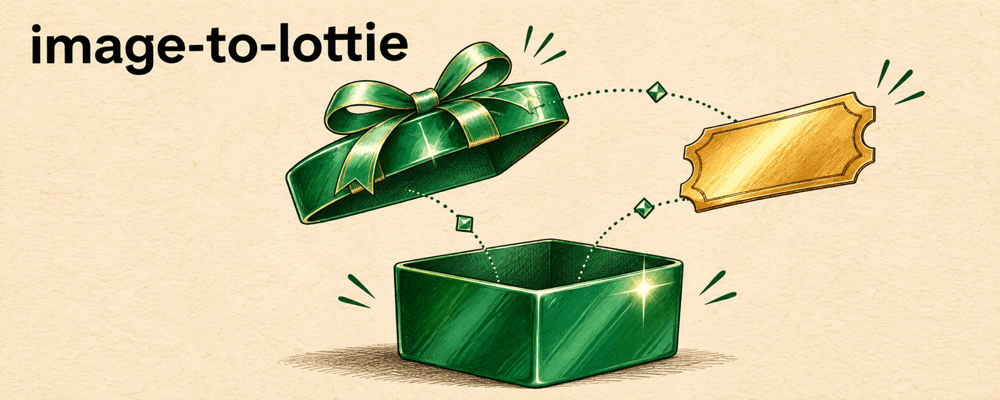
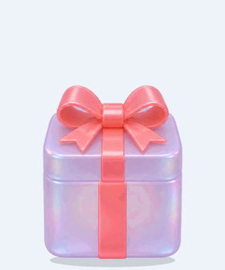
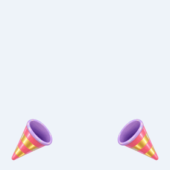
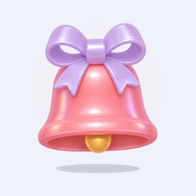
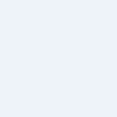
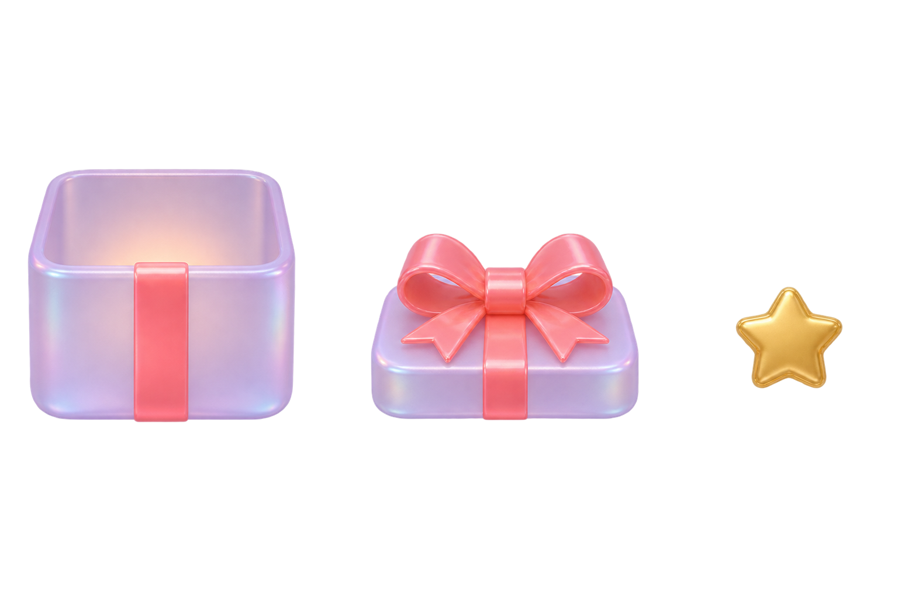
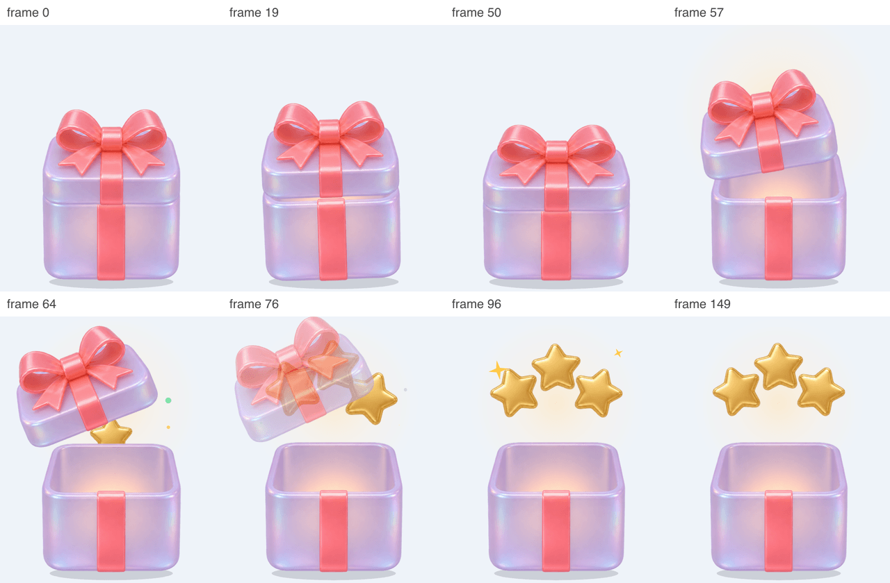

<p align="center">
  
</p>

<p align="center">
  <b>English</b> · <a href="README.ko.md">한국어</a>
</p>

# image-to-lottie

**Turn AI-generated images into Lottie and dotLottie animations, checked frame by frame without a browser.**

<p align="center">
  
  
  
</p>
<p align="center">
  
  
  
</p>

## What it is

A command line tool and an agent skill for Claude Code and Codex. You generate a few still images (a box, its lid, a reward), and it cuts them apart, fits them together, moves them with a motion preset, and writes Lottie JSON or a `.lottie` file. Every result can be rendered to PNG, a contact sheet, or a GIF with Skia's Skottie, the same Lottie player Chrome and Flutter use.

## Why it exists

Polished app animations are often made the cheap way: render a few 3D stills, then move them with 2D transforms. Doing that with an AI agent kept failing in the same places. Parts generated one by one did not match. A lid was placed by trial and error. The only way to see a frame was a browser screenshot, because the player draws with WebGL. Images ended up with the wrong paths. Existing image-to-Lottie tools only wrap one picture or a list of frames; none move separate parts with real motion. This tool fixes those steps so an agent can go from a prompt to a checked `.lottie` in one pass.

## What it does

| Command | Does |
| --- | --- |
| `split` | Cuts a part sheet (several objects on one transparent image) into one PNG per object. Nearby loose pieces join their object. |
| `fit` | Draws a lid on a base at several overlaps, labeled, so you pick the one that looks closed. |
| `spin` | Makes coin-style turning frames from one front image. |
| `build` | Applies a preset and writes Lottie JSON with its images, plus `.lottie` or inline JSON. |
| `render` | Renders frames headlessly with Skottie: PNG frames, a labeled contact sheet, or a GIF. |
| `check` | Confirms the file parses, every image resolves, and the middle and last frames are not blank. Warns when content touches the canvas edge and when an image is far larger than it is shown. |
| `pack` | Converts any Lottie to dotLottie (images inside) or to one JSON with base64 images. |
| `inspect`, `edit` | Lists the layers of any Lottie and changes one layer's position, scale, rotation, opacity, or timing. |

Presets:

| Preset | Parts | Plays |
| --- | --- | --- |
| `gift-open` | `base`, `lid`, `item` | Box shakes twice, the lid pops off, items rise and fan out. Once, then holds. |
| `hop` | `subject` | Crouch, jump with a wiggle, squash on landing, breathe. Loops. |
| `float` | `subject` | Gentle bob and sway, breathing shadow and glow. Loops. |
| `pop-in` | `subject` | Springs in with a glow burst, particles, and sparkles. Once, then holds. |
| `fanfare` | `popper` | Party poppers in both corners pull back, pop, and throw confetti that arcs and falls. Once, then holds. |
| `sequence` | frame images | Flipbook of images in file name order. Loops. |

## Example

The `examples/gift-open` folder, from one generated sheet to a `.lottie`:

<p align="center">
  
</p>

```console
$ image-to-lottie split examples/gift-open/sheet.png -o examples/gift-open/parts --names base,lid,item
base	475x450	examples/gift-open/parts/base.png
lid	475x337	examples/gift-open/parts/lid.png
item	200x190	examples/gift-open/parts/item.png

$ image-to-lottie fit examples/gift-open/parts/base.png examples/gift-open/parts/lid.png -o examples/gift-open/fit.png
sheet: examples/gift-open/fit.png
candidates: 130, 156, 182, 200, 217, 243
suggested starting point: overlap 200. Pick the smallest overlap where the opening is fully hidden.
```

At 156 a strip of light still shows; 182 is the smallest overlap that looks closed, so `examples/gift-open/config.json` uses `"overlap": 182`.

```console
$ image-to-lottie build examples/gift-open/config.json -o examples/gift-open/out/gift-open.json --lottie examples/gift-open/out/gift-open.lottie
lottie: examples/gift-open/out/gift-open.json (600x720, 150 frames @ 60 fps, once)
dotlottie: examples/gift-open/out/gift-open.lottie (728956 bytes)

$ image-to-lottie check examples/gift-open/out/gift-open.lottie
gift-open: 600x720, 60 fps, 150 frames (2.50s), 18 layers, 3 assets
frame 0: 37.6% visible
frame 74: 62.4% visible
frame 149: 58.6% visible
ok

$ image-to-lottie render examples/gift-open/out/gift-open.lottie --frames 0,19,50,57,64,70,96,last --sheet examples/gift-open/out/sheet.png --bg "#eef3f9"
sheet: examples/gift-open/out/sheet.png (frames 0, 19, 50, 57, 64, 70, 96, 149)
```

<p align="center">
  
</p>

The other animations at the top, each from one or two generated images: confetti is `fanfare`, the trophy is `hop`, the bell is `float`, the star is `pop-in`, and the coin is `spin` then `sequence`. Their configs and outputs are in `examples/`.

## Requirements

- Node.js 20 or later
- An image generator for the parts. Any works; the skill's prompts assume one that can make transparent backgrounds.

## Install

CLI, from the latest GitHub release:

```bash
npm install -g https://github.com/nathankim0/image-to-lottie/releases/latest/download/image-to-lottie.tgz
image-to-lottie presets
```

Or without installing:

```bash
npx -y github:nathankim0/image-to-lottie presets
```

Agent skill, for Claude Code, Codex, and other agents that read skills:

```bash
npx skills add nathankim0/image-to-lottie
```

## Usage

With the skill installed, ask in plain words, for example: "Make a gift box that opens and three coins pop out, as a .lottie." The skill tells the agent to generate the parts on one sheet, run `split` and `fit`, build, and check the frames before handing the file over.

By hand, a build config holds the preset, parts, and options. Paths are relative to the config:

```json
{
  "preset": "gift-open",
  "width": 600,
  "height": 720,
  "parts": { "base": "parts/base.png", "lid": "parts/lid.png", "item": "parts/item.png" },
  "options": { "overlap": 182, "items": 3, "itemWidth": 0.36 }
}
```

Flags work too:

```bash
image-to-lottie build --preset pop-in --subject star.png --size 400x400 -o out/star.json --lottie out/star.lottie
image-to-lottie spin coin.png -o frames --count 16 --size 240
image-to-lottie build --preset sequence --frames frames --fps 24 --option hold=2 -o out/coin.json
image-to-lottie render out/coin.json --gif out/coin.gif --bg "#ffffff"
image-to-lottie inspect out/star.json
image-to-lottie edit out/star.json --layer glow --opacity 60 -o out/star-soft.json
```

`image-to-lottie presets` prints every preset's parts and options.

Which output to ship:

| Output | When |
| --- | --- |
| `.lottie` | Web and apps with dotLottie players. One file, images inside. |
| JSON next to its images | Smallest JSON; serve the images from the same folder or set the asset path. |
| `pack --inline` JSON | One JSON for players that cannot read `.lottie`. Largest. |

Keep images near their display size before building; `spin --size` does this for frames, and `build` warns about images that are far too large. For a web app that serves the images from its own path, add `--asset-base /images/anim/` to `build`.

[`skills/image-to-lottie/references/pitfalls.md`](skills/image-to-lottie/references/pitfalls.md) lists the mistakes made while building these examples and what prevents each one.

## Repository layout

```text
src/cli.ts               command line
src/presets/             gift-open, hop, float, pop-in, fanfare, sequence
src/lottie/              keyframes, easing, layers, shared effects (glow, shadow, sparkles, particles)
src/image/               split, fit, spin, part loading
src/render/skottie.ts    headless Skottie rendering, contact sheets, GIF
src/pack/                .json and .lottie loading, dotLottie and inline export
src/edit/edit.ts         inspect and edit layers
skills/image-to-lottie/  agent skill and its references (part-sheet prompts, motion rules)
examples/                source art, configs, and rendered results
test/                    end-to-end tests
```

## Credits

- [Skia Skottie](https://skia.org/docs/user/modules/skottie/) through [canvaskit-wasm](https://www.npmjs.com/package/canvaskit-wasm) for rendering.
- [dotlottie-js](https://github.com/LottieFiles/dotlottie-web) for `.lottie` files, and [sharp](https://sharp.pixelplumbing.com/) for image work.
- [text-to-lottie](https://github.com/diffusionstudio/lottie) and LottieFiles' [motion-design-skill](https://github.com/LottieFiles/motion-design-skill) shaped the motion rules. They pair well with this tool: they cover vector and SVG animation, this one covers raster parts.
- Earlier image-to-Lottie tools showed useful pieces this one keeps: frame folders with a frame rate ([images-to-lottie-json](https://github.com/SebastianLiando/images-to-lottie-json)), base64 images for portability ([image-to-lottie-web](https://github.com/Binuka97/image-to-lottie-web)), and layer editing ([images-to-lottie-editor](https://github.com/raoufswe/images-to-lottie-editor)).

## License

MIT
